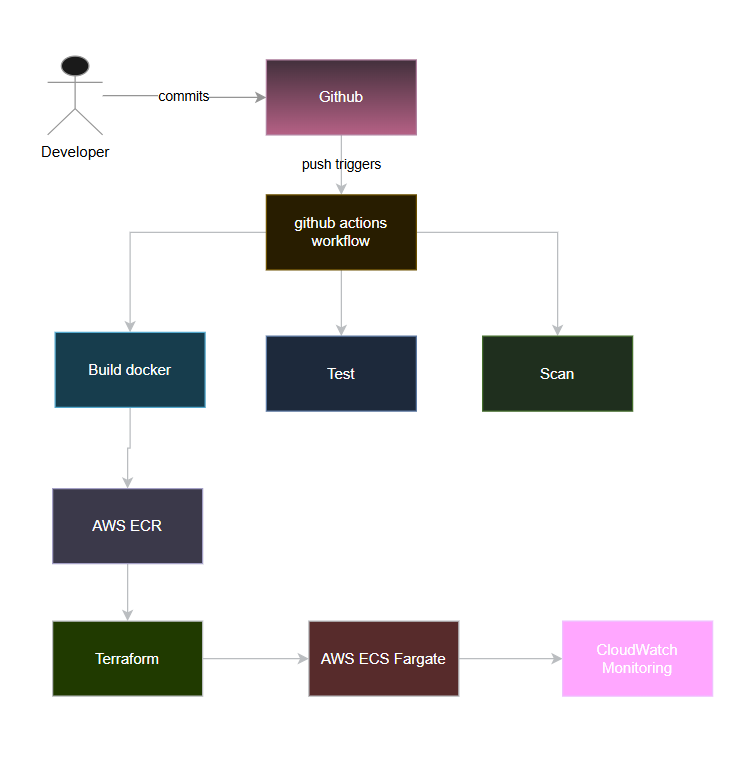

# System Architecture Overview

## High-Level Architecture

### Manual Deployment Flow
```
Developer → Code Changes → Manual Build → Manual Test → Manual Docker Build → 
Manual Push to ECR → Manual ECS Update → Manual Verification → Production
```

**Steps:**
1. Developer writes code locally
2. Manually build Docker image
3. Manually run tests
4. Manually push image to AWS ECR
5. Manually update ECS task definition
6. Manually update ECS service
7. Manually check CloudWatch logs
8. Manually verify application is running

**Time estimate:** 20-30 minutes per deployment

---

### Automated CI/CD Flow
```
Developer → Git Push → GitHub Actions Trigger → 
Build → Test → Security Scan → Push to ECR → Deploy to ECS → 
CloudWatch Monitoring → Production
```

**Steps:**
1. Developer writes code and pushes to GitHub
2. **GitHub Actions automatically:**
   - Checks out code
   - Builds Docker image
   - Runs unit tests
   - Runs security scans (Trivy)
   - Pushes image to ECR
   - Updates ECS task definition
   - Deploys to ECS service
   - Verifies health check
3. CloudWatch automatically collects logs and metrics
4. Alerts sent if deployment fails

**Time estimate:** 5-8 minutes per deployment (automated)

---

## AWS Infrastructure Components

### Networking
- **VPC** (Virtual Private Cloud)
  - Public subnets (for ALB)
  - Private subnets (for ECS tasks)
  - Internet Gateway
  - NAT Gateway (for private subnet internet access)

### Compute
- **ECS Cluster** (Fargate)
  - Task definitions (container specifications)
  - Services (desired count, load balancing)
  - Tasks (running container instances)

### Container Management
- **ECR** (Elastic Container Registry)
  - Stores Docker images
  - Image scanning enabled
  - Lifecycle policies

### Load Balancing
- **Application Load Balancer**
  - Distributes traffic
  - Health checks
  - SSL/TLS termination (optional)

### Security
- **IAM Roles and Policies**
  - ECS task execution role
  - ECS task role
  - GitHub Actions deployment role
- **Security Groups**
  - ALB security group
  - ECS tasks security group

### Monitoring
- **CloudWatch**
  - Logs: Application logs, ECS logs
  - Metrics: CPU, memory, network
  - Dashboards
  - Alarms

---

## Data Flow

### Request Flow (Production)
```
User → Route 53 (DNS) → Application Load Balancer → 
ECS Fargate Tasks → Flask Application → Response
```

### CI/CD Pipeline Flow
```
Code Push → GitHub → GitHub Actions → 
Docker Build → ECR → Terraform (if infra changes) → 
ECS Deployment → CloudWatch Logs
```

---

## Technology Integration Map

| Layer | Technology | Purpose |
|-------|-----------|---------|
| Source Control | GitHub | Code repository, pipeline trigger |
| CI/CD | GitHub Actions | Automation orchestration |
| Application | Python Flask | Web application logic |
| Containerization | Docker | Application packaging |
| Registry | AWS ECR | Container image storage |
| Infrastructure | Terraform | IaC for AWS resources |
| Orchestration | AWS ECS Fargate | Container deployment |
| Networking | AWS VPC, ALB | Traffic routing |
| Monitoring | AWS CloudWatch | Logs, metrics, alarms |
| Security | Trivy, IAM | Scanning, access control |

---

## Security Architecture

### Secrets Management
- GitHub Secrets: AWS credentials, API keys
- AWS Secrets Manager: Database passwords (if needed)
- Environment variables: Non-sensitive config

### Network Security
- Security groups with least privilege
- Private subnets for ECS tasks
- Public subnet only for load balancer

### Container Security
- Image scanning before deployment
- Non-root user in container
- Read-only root filesystem (where possible)

---

## Scalability Considerations

### Current Design (MVP)
- 2 ECS tasks (redundancy)
- Auto-scaling disabled (cost control)
- Single region deployment

### Future Enhancements (Out of Scope)
- Auto-scaling based on CPU/memory
- Multi-region deployment
- Database integration
- CDN for static content

---

## Diagram 
